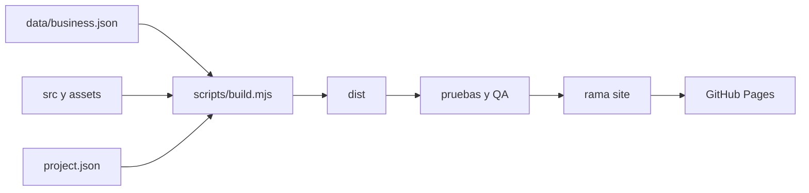

# Arquitectura y mapa del código

Identificador estable del proyecto: `tu-gimnasio-santa-lucia`. Versión de esta arquitectura: 2. El repositorio es la unidad de trabajo portátil; no requiere los chats, plugins o rutas de la PC del autor.

| Parte                       | Responsabilidad y contrato                                                                                                               |
| --------------------------- | ---------------------------------------------------------------------------------------------------------------------------------------- |
| `project.json`              | Identidad técnica, URL oficial, repositorio y nombres de ramas. No contiene credenciales.                                                |
| `data/business.json`        | Datos del negocio y actividades. Fuente única para contacto, horario, valoración y JSON-LD.                                              |
| `data/business.schema.json` | Ayuda de edición JSON Schema; documenta campos, tipos y restricciones. El build valida además los contratos necesarios en JavaScript.    |
| `assets/manifest.json`      | Nombres, dimensiones y rol de los originales. WebP sólo cuando la conversión sin pérdida es más liviana. PNG permanece como alternativa. |
| `src/index.template.html`   | Estructura semántica y textos editoriales. Los marcadores `{{nombre}}` se resuelven al generar.                                          |
| `src/styles.css`            | Tokens y reglas agrupadas por sección; diseño fluido, accesibilidad, impresión y movimiento reducido.                                    |
| `src/site.js`               | Mejoras opcionales de compartir y copiar. Nunca contiene los datos del negocio: toma la URL del enlace canónico generado.                |
| `scripts/build.mjs`         | Valida, escapa, genera JSON-LD/CSP/SRI y produce únicamente archivos públicos.                                                           |
| `scripts/check.mjs`         | Sintaxis, pruebas de contratos, generación reproducible y límites de publicación. No requiere instalar dependencias.                     |
| `scripts/browser-check.mjs` | Navegadores, vistas, accesibilidad, teclado, texto ampliado, ausencia de JS, portapapeles y QR. Requiere dependencias de desarrollo.     |
| `scripts/preview.mjs`       | Servidor local de lectura en 127.0.0.1. Sólo sirve archivos de dist. Al abrir la portada, regenera la salida.                            |
| `scripts/backup.mjs`        | Respaldo fuera del repositorio, copia verificada e historial Git en bundle.                                                              |
| `scripts/publish.mjs`       | Publicación explícita sin force-push. Comprueba origen, ramas, limpieza, backup y QA exacto antes de actualizar site.                    |
| `dist/`                     | Resultado generado, ignorado por Git en main; no editar manualmente.                                                                     |
| `artifacts/`                | Capturas e informes de la PC actual; ignorados por Git y nunca publicados.                                                               |

## Funciones y nombres estables

Los recursos con `archived: true` se conservan en la fuente para recuperar los originales, pero nunca se copian a la publicación. No reutilizar afiches con horarios antiguos como información vigente.

Se usa camelCase en funciones JavaScript, nombres descriptivos en inglés y documentación explicativa en español. Las etiquetas visibles permanecen en español rioplatense. Los identificadores de actividad son ASCII en kebab-case, por ejemplo `gimnasia-grupal`; no dependen del texto traducido ni del orden.

| Función                                           | Entrada → salida; efectos                                                                                        |
| ------------------------------------------------- | ---------------------------------------------------------------------------------------------------------------- |
| `validateBusinessData(data, project)`             | Objetos JSON → datos válidos; lanza error para información inválida o enlaces inseguros.                         |
| `validateAssetManifest(assets)` | Manifiesto → conjunto de archivos declarados; rechaza rutas inseguras y dimensiones o estados inválidos. |
| `escapeHtml(value)`                               | Valor → texto seguro para un marcador HTML/atributo.                                                             |
| `serializeJsonLd(value)`                          | Objeto → JSON que no puede cerrar su etiqueta script.                                                            |
| `renderTemplate(template, replacements, rawKeys)` | Texto y mapa → HTML; falla si un marcador no tiene valor. Sólo el generador define los fragmentos raw admitidos. |
| `buildSite(outputDirectory)`                      | Ruta opcional → manifiesto de salida; escribe artefactos públicos deterministas.                                 |
| `startPreview(port)`                              | Puerto → `{server,url}`; el llamador es responsable de cerrar el servidor.                                       |
| `createBackup()`                                  | Configuración opcional por entorno → ruta del respaldo verificado.                                               |
| `copyOfficialUrl()`                               | Clic → copia canónica o campo manual; anuncia el resultado.                                                      |
| `showManualCopy()`                                | Sin permisos de portapapeles → campo etiquetado, enfocado y seleccionable.                                       |
| `shareOfficialPage()`                             | Clic → compartir nativo o copiar; cancelar no genera error.                                                      |

## Contratos añadidos en la edición aniversario

`anniversary` guarda las cifras conmemorativas y el año de referencia. `relocation` guarda el anuncio de la sede futura; `address` conserva la actual. Los estados y la migración al abrir se explican en [mudanza y aniversario](MUDANZA-Y-ANIVERSARIO.md). Las cuatro cifras no son un reloj ni dependen de la fecha del equipo.

`assets.fonts.display` declara el archivo de fuente local, su licencia, origen fijado y SHA-256. El build comprueba la huella y publica únicamente los archivos permitidos. La licencia y la fuente viajan con el repositorio. Nunca se consulta un servidor de fuentes al visitar la página.

| Función | Responsabilidad |
| --- | --- |
| `initializeSharing()` | Conecta los controles de compartir/copiar; no depende de la animación ni de componentes ajenos. |
| `initializeMotion()` | Comprueba APIs y preferencia de movimiento; observa una sola entrada de cada sección. No oculta contenido al iniciar. |
| `animateSection(element)` | Aplica entradas diferenciadas a tiempo, anuncio y gráfica, con Web Animations nativas y sin bucles. |
| `animateMetric(element)` | Anima una cifra fija durante 1,2 segundos; no cambia su alternativa accesible ni calcula tiempo transcurrido. |
| `restoreMetric(element)` | Restituye el valor final declarado en data-count con formato es-AR. |
| `handleMotionPreference()` | Cancela efectos y fotogramas activos y restaura los valores al activarse movimiento reducido. |

Estos métodos son privados a la mejora del navegador; el HTML generado no necesita invocarlos para mostrar datos. Preguntas frecuentes usa details/summary nativos y permanece disponible sin JavaScript. Los selectores data-reveal y data-count conectan el HTML a las mejoras; los nombres de actividad siguen siendo los IDs estables de los datos.

## Seguridad de la generación

Los marcadores normales se escapan por defecto. Los únicos fragmentos raw provienen del generador, que escapa a su vez cada dato de las actividades y atributos de imágenes. El JSON-LD tiene serialización segura y su hash CSP se recalcula en cada build. CSS y JavaScript tienen nombres derivados del contenido e integridad SRI: un cambio invalida el nombre anterior y evita depender de una copia antigua en caché.

No hay llamadas a APIs de negocio, paneles privados, formularios, almacenamiento de usuarios, cookies de seguimiento, scripts de terceros ni fuentes externas. Las dependencias de QA son sólo de desarrollo y quedan fuera de dist.

`.gitattributes` fija finales de línea LF y conserva imágenes como binarios, para que un traslado entre Windows y Linux no cambie por sí solo las huellas del build.

El manifiesto `build-manifest.json` contiene tamaños y SHA-256 de los archivos generados. `qa-report.json` identifica la huella de ese manifiesto; una QA antigua no habilita una publicación nueva. No se incluye fecha variable en el build, por lo que el mismo contenido produce los mismos bytes.

## Relación con la implementación anterior

La versión anterior usaba React/Vinext en una carpeta externa y una copia HTML actualizada a mano. Ese código se conserva localmente como histórico; ya no es la fuente de publicación. No se debe sincronizar de vuelta ni reconstruir la web desde ese starter. La rama main actual contiene todo lo necesario para reproducir la web sin esa carpeta.

Una migración futura puede cambiar implementación, pero debe conservar o migrar de forma explícita el contrato de datos, la URL, los recursos y las pruebas de interacción. No hace falta conservar un proveedor de IA ni repetir prompts para interpretar este proyecto.
